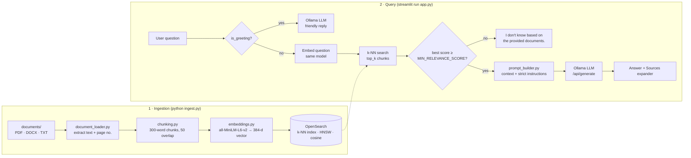

# DocuMind — Local RAG Assistant

A fully local, offline-capable **Retrieval-Augmented Generation (RAG)** knowledge assistant. Drop your own PDF, DOCX, or TXT files into a folder, then ask questions in a chat UI and get answers grounded **only** in that content — with source citations (file + page).

No cloud LLM API, no API keys, no data leaving your machine. Embeddings run locally with `sentence-transformers`, retrieval runs on a self-hosted **OpenSearch** k-NN index, and answers come from a local **Ollama** model.

---

## How it works (end-to-end flow)

The system has two independent phases that share one OpenSearch index.



### Phase 1 — Ingestion (`ingest.py`)
1. **Load** — `document_loader.py` reads every PDF (page by page, via `pypdf`), DOCX (`python-docx`) and TXT file in `documents/`, keeping the filename and page number as metadata. Corrupt/unsupported files are logged and skipped, not fatal.
2. **Chunk** — `chunking.py` splits text into overlapping word windows (`CHUNK_SIZE=300`, `CHUNK_OVERLAP=50`). Overlap keeps sentences that straddle a boundary retrievable from either side.
3. **Embed** — `embeddings.py` turns every chunk into a 384-dimensional vector with `all-MiniLM-L6-v2`.
4. **Index** — `vector_store.py` creates a k-NN index (HNSW graph, cosine similarity) and bulk-inserts `{text, source, page, chunk_index, embedding}`.

### Phase 2 — Query (`app.py`)
1. **Small-talk shortcut** — `is_greeting()` detects "hi", "thanks", "how are you", "theek hai"… and replies directly via the LLM without touching the index.
2. **Embed the question** with the *same* model used at ingestion (vectors must live in the same space).
3. **Retrieve** the `TOP_K` nearest chunks from OpenSearch.
4. **Relevance gate** — if the best score is below `MIN_RELEVANCE_SCORE`, the app answers "I don't know" *without* calling the LLM. This is the main anti-hallucination guard.
5. **Prompt** — `prompt_builder.py` builds a prompt with numbered, source-labelled chunks and an instruction to answer *only* from that context.
6. **Generate** — `llm_client.py` streams the answer from Ollama's REST API; the UI shows it with an expandable **Sources** list.

Every failure (OpenSearch down, Ollama down, model missing, embedding error) is caught and shown as a friendly message instead of a stack trace.

---

## Tech stack — what and why

| Tool | Role in the project | Why this choice |
|---|---|---|
| **Python 3.10+** | Whole codebase | The ML/RAG ecosystem (sentence-transformers, PyTorch) lives here. |
| **sentence-transformers** (`all-MiniLM-L6-v2`) | Text → vector embeddings | Runs on CPU, small (~90 MB), fast, good semantic quality; 384-d vectors keep the index light. Free and offline after first download. |
| **OpenSearch 2.13** (k-NN plugin) | Vector database + metadata store | Open-source (Apache 2.0) Elasticsearch fork with built-in approximate k-NN (HNSW). Stores vectors *and* text/metadata together, scales beyond a toy in-memory store, and comes with Dashboards for inspecting the index. |
| **Docker Compose** | Runs OpenSearch + Dashboards | One command (`docker-compose up -d`) instead of a manual Java/OpenSearch install; same setup on every OS. |
| **Ollama** (`llama3.2:1b` / `llama3.1`) | Local LLM for answer generation | Runs open models locally behind a simple REST API — no API key, no cost, full privacy. Model is swappable via one `.env` value. |
| **Streamlit** | Chat web UI | A working chat interface in ~100 lines of Python; `st.cache_resource` keeps the model and DB client loaded across reruns. |
| **pypdf / python-docx** | Text extraction | Pure-Python, lightweight readers; pypdf gives page-level text so answers can cite page numbers. |
| **requests** | HTTP calls to Ollama | Simple streaming over Ollama's `/api/generate` — no extra SDK needed. |
| **python-dotenv** | Configuration | All settings live in `.env` and flow through `config.py`; nothing is hardcoded elsewhere. |
| **pytest** | Tests | 48 unit tests; OpenSearch is mocked, so tests need no running services. |
| **black / ruff** | Formatting / linting | Consistent style and fast static checks. |

### Why RAG instead of just asking an LLM?
An LLM alone doesn't know your private documents and will confidently invent answers. RAG retrieves the relevant passages first and forces the model to answer from them — so answers are **grounded, citable, and up to date** with whatever you put in `documents/`, without fine-tuning.

---

## Prerequisites

- Python 3.10+
- Docker + Docker Compose (for OpenSearch)
- [Ollama](https://ollama.com) installed
- ~8 GB RAM and ~10 GB free disk

## Setup

```bash
# 1. Clone
git clone https://github.com/<your-username>/<repo-name>.git
cd <repo-name>

# 2. Virtual environment
python -m venv .venv
source .venv/bin/activate        # macOS/Linux
.venv\Scripts\Activate.ps1       # Windows PowerShell

# 3. Dependencies
pip install -r requirements.txt

# 4. Config
cp .env.example .env

# 5. Start OpenSearch (+ Dashboards on http://localhost:5601)
docker-compose up -d

# 6. Pull an Ollama model (must match OLLAMA_MODEL in .env)
ollama pull llama3.2:1b

# 7. Add your documents
cp ~/my-notes.pdf documents/

# 8. Ingest
python ingest.py

# 9. Run the app → http://localhost:8501
streamlit run app.py
```

> **Re-ingesting:** `ingest.py` appends to the existing index. Before ingesting a changed document set, delete the old index to avoid duplicate chunks:
> `curl -X DELETE http://localhost:9200/rag_documents`

## Configuration

All settings live in `.env` (see `.env.example`) and are loaded only through `config.py`.

| Variable | Purpose | Default |
|---|---|---|
| `DOCUMENTS_DIR` | Folder scanned by `ingest.py` | `documents` |
| `CHUNK_SIZE` | Words per chunk | `300` |
| `CHUNK_OVERLAP` | Words shared between consecutive chunks | `50` |
| `EMBEDDING_MODEL_NAME` | sentence-transformers model | `all-MiniLM-L6-v2` |
| `EMBEDDING_DIM` | Embedding vector size | `384` |
| `OPENSEARCH_HOST` / `OPENSEARCH_PORT` | OpenSearch address | `localhost` / `9200` |
| `OPENSEARCH_INDEX_NAME` | Index for chunks + vectors | `rag_documents` |
| `OPENSEARCH_USE_SSL` / `OPENSEARCH_VERIFY_CERTS` | TLS settings | `false` / `false` |
| `OPENSEARCH_USERNAME` / `OPENSEARCH_PASSWORD` | Basic auth | `admin` / `admin` |
| `TOP_K` | Chunks retrieved per question | `4` |
| `MIN_RELEVANCE_SCORE` | Below this best-match score, answer "I don't know" | `0.5` |
| `OLLAMA_BASE_URL` | Ollama server | `http://localhost:11434` |
| `OLLAMA_MODEL` | Ollama model tag | `llama3.1` |
| `OLLAMA_TIMEOUT` | Request timeout (s) | `120` |
| `LOG_LEVEL` | DEBUG / INFO / WARNING / ERROR | `INFO` |

## Tests & code quality

```bash
pytest           # no OpenSearch or Ollama needed — clients are mocked
black .
ruff check .
```

## Troubleshooting

- **OpenSearch not reachable** — check `docker-compose ps` and `curl http://localhost:9200`.
- **Ollama model not found** — `ollama pull <model>` and make sure `OLLAMA_MODEL` matches the tag exactly.
- **Always "I don't know"** — run `python ingest.py` after adding files; try lowering `MIN_RELEVANCE_SCORE`. If you changed the embedding model, delete the index and re-ingest (dimensions must match).
- **Slow answers** — use a smaller model (`llama3.2:1b`) or raise `OLLAMA_TIMEOUT`.

## Project structure

```
.
├── app.py                 # Streamlit chat UI + query pipeline
├── ingest.py              # CLI: load → chunk → embed → index
├── config.py              # All settings from .env
├── src/
│   ├── document_loader.py # PDF/DOCX/TXT → text + metadata
│   ├── chunking.py        # Overlapping word-window chunks
│   ├── embeddings.py      # sentence-transformers wrapper (cached)
│   ├── vector_store.py    # OpenSearch: create index, bulk insert, k-NN search
│   ├── prompt_builder.py  # Grounded prompt + small-talk detection
│   ├── llm_client.py      # Ollama REST client (streaming)
│   └── logger.py          # Central logging
├── tests/                 # pytest suite (mocked services)
├── documents/             # Your source files (git-ignored)
├── docker-compose.yml     # OpenSearch + Dashboards
├── requirements.txt
└── .env.example
```

## License

MIT
